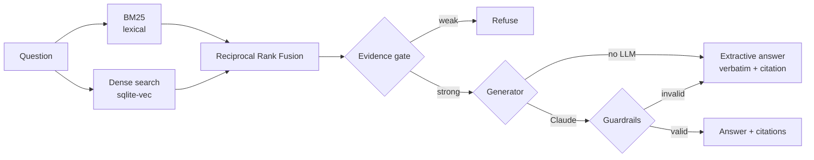

# grounded-rag

[](https://github.com/Sr-Stark08/grounded-rag/actions/workflows/ci.yml)


A **RAG service that answers questions about company documents with citations — or explicitly refuses
when the documents don't contain the answer.** Built for the questions field crews actually ask
("¿cada cuánto se reponen los guantes?", "¿quién autoriza el retiro de bodega?").

> **Q:** ¿Cada cuánto se reponen los guantes?
> **A:** Los guantes se reponen cada 15 días o antes si están dañados. `[epp#2]`
>
> **Q:** ¿Cuál es el precio del dólar hoy?
> **A:** No encontré información sobre eso en los documentos disponibles. *(abstained: insufficient evidence)*

It runs **100% free and offline** by default, and can optionally use Claude for generation.
Part of my portfolio around [Patagon](https://patagoninventario.cl), a WhatsApp AI assistant for SMB operations.
Sample documents are fictional.

## Architecture



| Component | Choice | Why |
|---|---|---|
| Chunking | Section-aware markdown chunks with stable ids (`epp#2`) | Citations stay valid across re-indexing |
| Lexical retrieval | BM25 implemented from scratch, light Spanish stemming | Exact terms (SKUs, numbers, roles) matter in operations |
| Dense retrieval | Pluggable embedder + **sqlite-vec** vector index | A real vector DB in one file, no server to run |
| Fusion | Reciprocal Rank Fusion | Combines rankings without tuning score scales |
| Generation | Extractive by default; Claude Haiku optional | Works with zero API cost; LLM only adds fluency |
| API | FastAPI with typed request/response models | `POST /ask` |

## Hallucination guardrails

| Layer | Rule |
|---|---|
| **Evidence gate** | If the best chunk covers less than 50% of the question's terms, refuse — the LLM is never called |
| **Prompt contract** | Answer only from `<source>` tags, cite every claim as `[id]`, or reply `NO_EVIDENCE` |
| **Citation check** | Answers with no citations, or citing chunks that weren't retrieved, are rejected |
| **Number check** | Every number in the answer must appear in the cited sources (`30 días` is rejected if the source says `15`) |
| **Safe fallback** | A rejected LLM answer is never shown: the user gets the verbatim evidence instead, and the reason is logged in `notes` |

## Evaluation

```bash
python -m grounded_rag eval
```

```
Recall@K            1.00  (12 answerable questions)
MRR                 1.00
Abstention accuracy 1.00  (3 unanswerable questions)
PASS
```

`evals/questions.jsonl` contains answerable questions with their expected source document and
unanswerable ones that must be refused. **CI fails if recall or abstention accuracy drops below 0.9**,
so any change to chunking, stemming or thresholds is measured, not guessed.

## Quick start

Requires Python 3.11+.

```bash
git clone https://github.com/Sr-Stark08/grounded-rag.git
cd grounded-rag
python -m venv .venv
# Windows: .venv\Scripts\activate    macOS/Linux: source .venv/bin/activate
pip install -e ".[dev]"

python -m grounded_rag ask "¿Quién autoriza el retiro de materiales de bodega?"
pytest -q
```

### Run the API

```bash
uvicorn grounded_rag.api:create_app --factory --reload
```

```bash
curl -X POST http://localhost:8000/ask -H "Content-Type: application/json" \
  -d '{"question": "¿Es obligatorio usar casco en la obra?"}'
```

### Optional upgrades

```bash
pip install -e ".[dense]"   # free local neural embeddings (fastembed, ONNX, CPU)
pip install -e ".[llm]"     # Claude generation; set ANTHROPIC_API_KEY
python -m grounded_rag --llm ask "¿Cada cuánto se reponen los guantes?"
```

Use your own documents by pointing `--docs` (CLI) or `DOCS_DIR` (API) to a folder of `.md` files.

## Tests

18 tests cover stemming, chunk ids, the vector index, retrieval, abstention, every guardrail
(with a fake LLM, so no API key is needed), the API, concurrent requests and the eval quality gate.

## Limitations

- The default `HashingEmbedder` is lexical (character n-grams), not semantic. Install the `dense` extra
  for multilingual neural embeddings.
- The evaluation set is small (15 questions) and built for the sample corpus; a real deployment needs
  questions collected from actual users.
- The evidence threshold (`min_coverage=0.5`) was tuned on this corpus and should be re-validated on new data.

## Author

**Jorge Fraile Pereira** — AI Agent Developer, founder of [Patagon](https://patagoninventario.cl).
License: [MIT](LICENSE)
